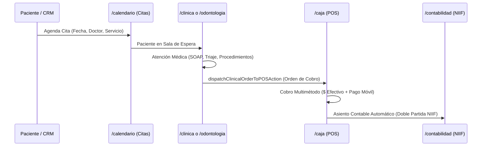
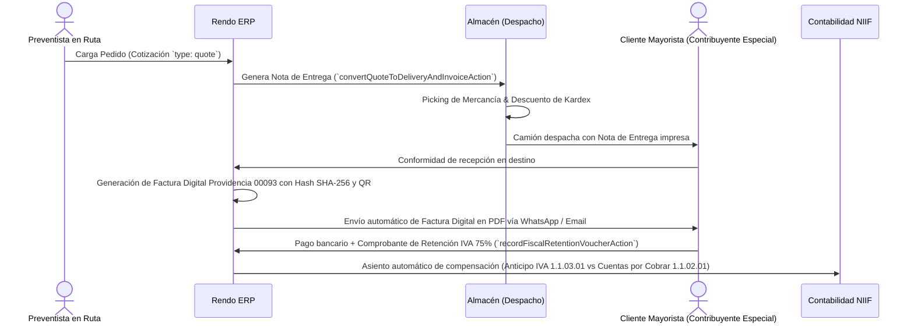

# 🔄 Flujos de Datos Transversales (Interoperabilidad de Punta a Punta)

> **Propósito:** Trazar cómo los datos viajan de un módulo a otro para evitar que los módulos funcionen como silos aislados.

---

## 1. Flujo Salud: Cita ➔ Consulta Médica ➔ Caja POS ➔ Contabilidad

1. **Agendamiento:** Se crea el turno en `appointments` vinculado al `client_id` (en `entities`).
2. **Atención Médica:** El médico registra la consulta en `saveClinicalEncounterAction` (o `dental.ts` / `ginecologia.ts`). Se actualizan los antecedentes y el expediente de la especialidad.
3. **Despacho a Caja:** La orden se envía a Caja POS (`dispatchClinicalOrderToPOSAction`), precargando el ticket con el paciente y los honorarios/servicios correspondientes.
4. **Checkout en Mostrador:** El cajero cobra en efectivo, divisas o pago electrónico. Si el inventario incluye insumos médicos, se descuentan atómicamente con `decrement_item_stock`.
5. **Impacto Contable:** Se registra un documento de venta en `documents` y se asienta automáticamente en `journal_entries` afectando Caja/Bancos e Ingresos.

---

## 2. Flujo Cadena de Suministro: Compras ➔ Almacén ➔ Kardex ➔ Contabilidad

1. **Órdenes de Compra (`/compras`):** Registro de requerimiento a proveedores en `documents` (`type: 'purchase_order'`).
2. **Recepción de Mercancía:** Al recibir los productos, se valida la coincidencia con la factura del proveedor (3-Way Match).
3. **Ingreso a Kardex (`/inventario`):** Se llama a `adjustItemStockAction` para sumar las unidades al stock real con su costo unitario exacto.
4. **Asiento de Compra:** Se debita la cuenta `1.1.04 (Inventario de Mercancías)` y se acredita `1.1.01.02 (Bancos)` o `2.1.01 (Cuentas por Pagar Proveedores)`.

---

## 3. Flujo CRM & Saldos por Cobrar (Ventas a Crédito)

1. En `/caja`, el cajero selecciona pago a Crédito.
2. La factura se emite en estado pendiente.
3. El saldo deudor se suma atómicamente a `entities.metadata.debt_balance`.
4. En `/clientes`, el cliente muestra su semáforo de deuda y el botón para registrar abonos parciales, balanceando la cuenta `1.1.02.01 (Cuentas por Cobrar)`.

---

## 4. Flujo Distribuidora & Facturación Digital (Providencia SNAT/2026/00093)

1. **Preventa / Cotización:** El vendedor en calle toma el pedido desde la app móvil de Rendo con listas de precio mayoristas.
2. **Despacho Logístico:** Se emite la Nota de Entrega (`type: work_order`, `actual_type: delivery_order`) que ampara la movilización de la carga.
3. **Facturación Digital Telemática:** Una vez entregado el pedido, se timbra la Factura Digital cumpliendo con el Artículo 8 de la Providencia 00093 (estampado con segundos `HH:MM:SS`, bimoneda BCV, domicilio fiscal del comprador y hash SHA-256).
4. **Cruce de Retenciones Fiscales:** Si el cliente mayorista retiene el 75% o 100% de IVA, se registra el comprobante fiscal, deduciéndolo del saldo por cobrar y cargándolo a la cuenta de activo `1.1.03.01 (Anticipo de IVA por Compensar)`.

---

## 5. Gobernanza Central de Activación Fiscal & Blindaje Anti-Manipulación

1. **Jerarquía Exclusiva:** Los parámetros fiscales (`taxes_enabled`, `region`, `tax_rate`, `enable_igtf`, `igtf_rate`) son de **solo lectura** para los usuarios del tenant en `/configuracion`.
2. **Control Centralizado en Rendo Hub (`/admin/tenant/[id]`):** Únicamente el Superadministrador de la plataforma puede activar el régimen formal o alterar las tasas impositivas.
3. **Blindaje en Servidor (`updateTenantSettings`):** Cualquier solicitud proveniente de un actor no-superadmin que intente enviar `fiscal_settings` o `tax_rate` es neutralizada en el backend, restaurando los valores originales de la base de datos.
4. **Impacto en Contabilidad NIIF:**
   - Si `taxes_enabled = false`: El sistema opera en "Solo Gestión Interna" (0% IVA). La cuenta `2.1.02.01 (Débito Fiscal por Pagar)` se mantiene en 0.
   - Si `taxes_enabled = true`: El sistema opera como "Contribuyente Formal". Cada venta desglosa IVA/IGTF, timbra el documento con hash SHA-256 y alimenta el Libro de Ventas Fiscal para la declaración de la Forma 30.
