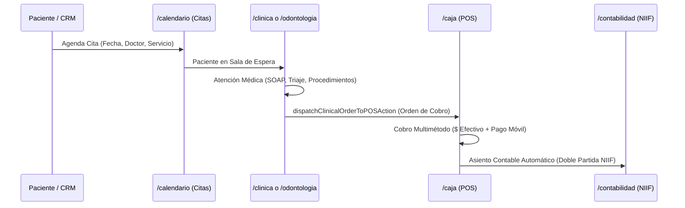

# 🔄 Flujos de Datos Transversales (Interoperabilidad de Punta a Punta)

> **Propósito:** Trazar cómo los datos viajan de un módulo a otro para evitar que los módulos funcionen como silos aislados.

---

## 1. Flujo Salud: Cita ➔ Consulta Médica ➔ Caja POS ➔ Contabilidad

1. **Agendamiento:** Se crea el turno en `appointments` vinculado al `client_id` (en `entities`).
2. **Atención Médica:** El médico registra la consulta en `saveClinicalEncounterAction` (o `dental.ts` / `ginecologia.ts`). Se actualizan los antecedentes y el expediente de la especialidad.
3. **Despacho a Caja:** La orden se envía a Caja POS (`dispatchClinicalOrderToPOSAction`), precargando el ticket con el paciente y los honorarios/servicios correspondientes.
4. **Checkout en Mostrador:** El cajero cobra en efectivo, divisas o pago electrónico. Si el inventario incluye insumos médicos, se descuentan atómicamente con `decrement_item_stock`.
5. **Impacto Contable:** Se registra un documento de venta en `documents` y se asienta automáticamente en `journal_entries` afectando Caja/Bancos e Ingresos.

---

## 2. Flujo Cadena de Suministro: Compras ➔ Almacén ➔ Kardex ➔ Contabilidad

1. **Órdenes de Compra (`/compras`):** Registro de requerimiento a proveedores en `documents` (`type: 'purchase_order'`).
2. **Recepción de Mercancía:** Al recibir los productos, se valida la coincidencia con la factura del proveedor (3-Way Match).
3. **Ingreso a Kardex (`/inventario`):** Se llama a `adjustItemStockAction` para sumar las unidades al stock real con su costo unitario exacto.
4. **Asiento de Compra:** Se debita la cuenta `1.1.04 (Inventario de Mercancías)` y se acredita `1.1.01.02 (Bancos)` o `2.1.01 (Cuentas por Pagar Proveedores)`.

---

## 3. Flujo CRM & Saldos por Cobrar (Ventas a Crédito)

1. En `/caja`, el cajero selecciona pago a Crédito.
2. La factura se emite en estado pendiente.
3. El saldo deudor se suma atómicamente a `entities.metadata.debt_balance`.
4. En `/clientes`, el cliente muestra su semáforo de deuda y el botón para registrar abonos parciales, balanceando la cuenta `1.1.02.01 (Cuentas por Cobrar)`.
